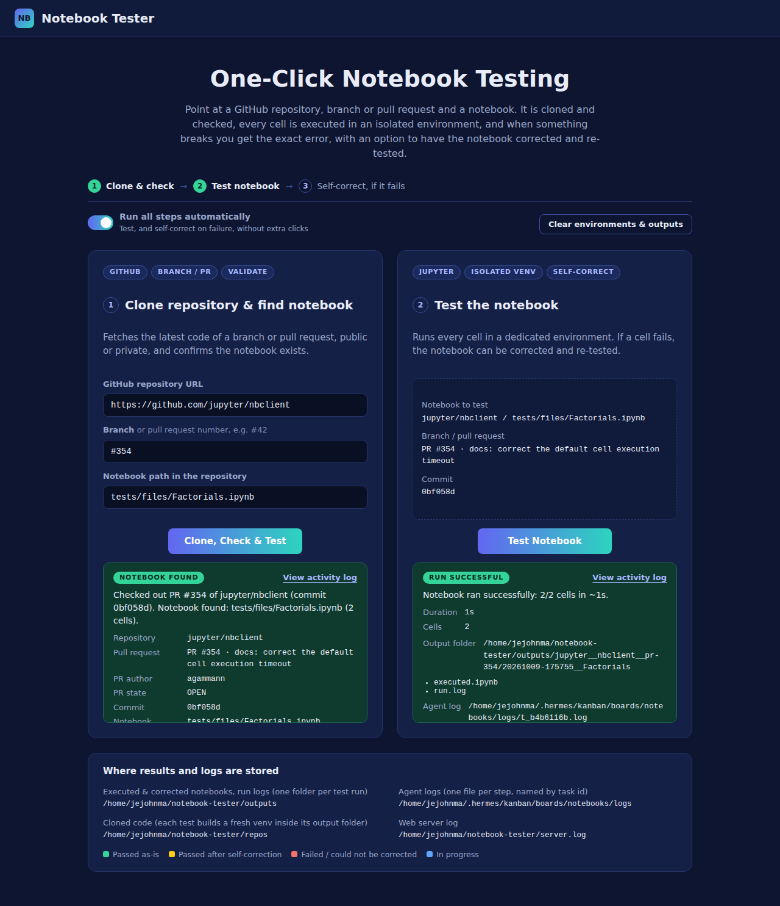
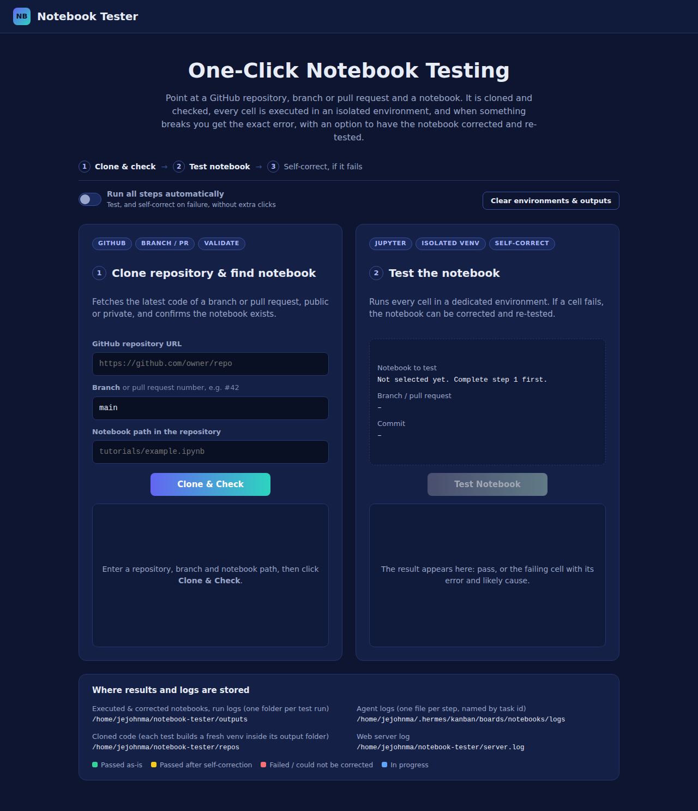
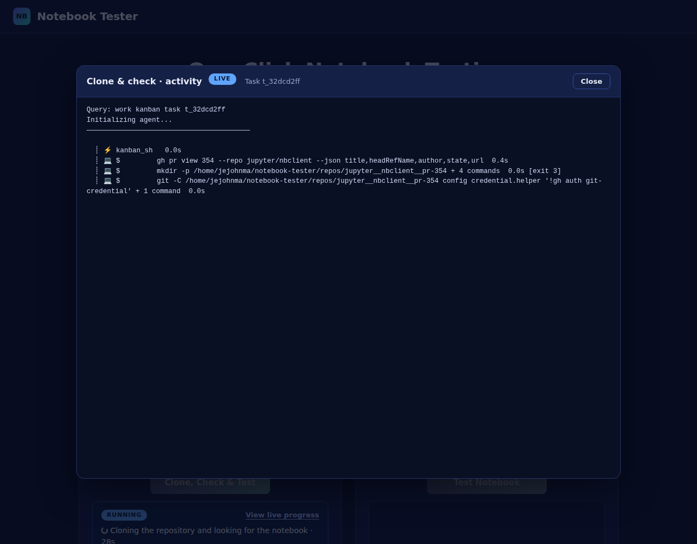
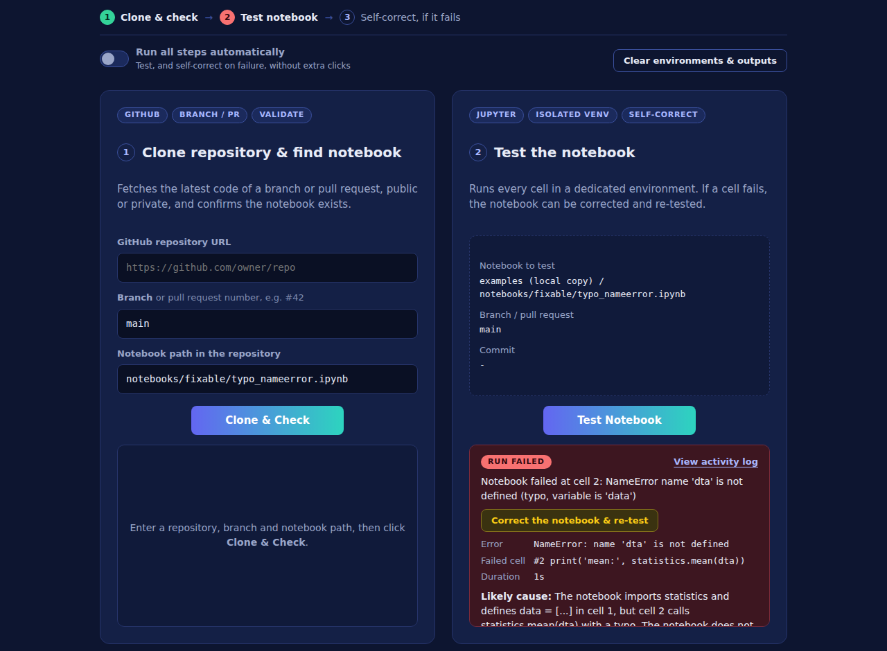
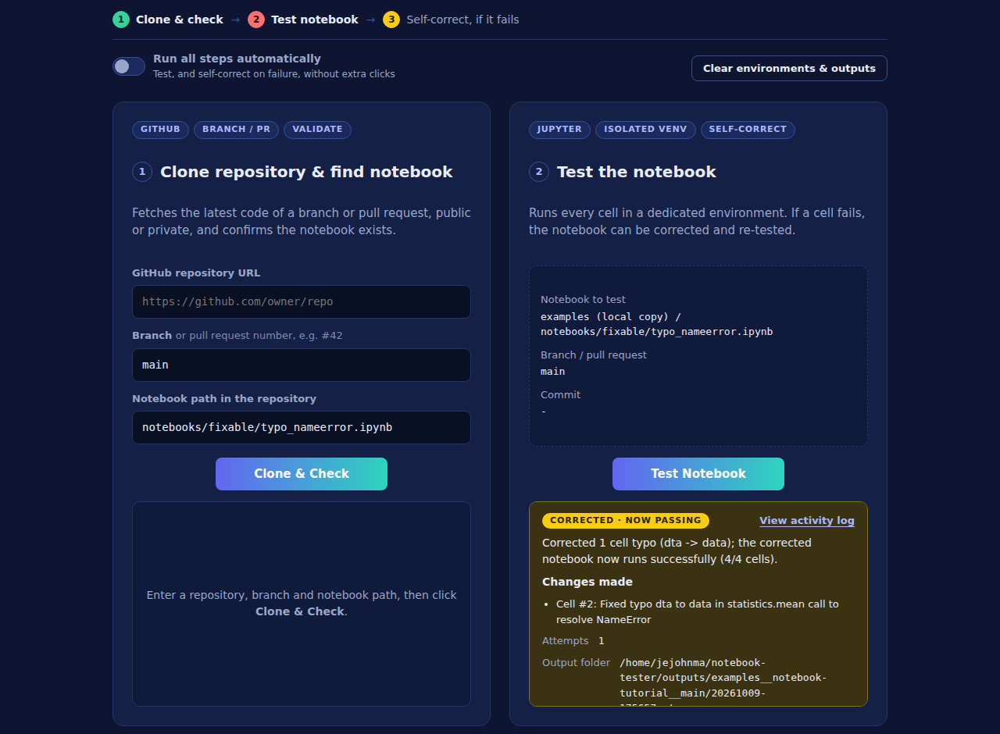
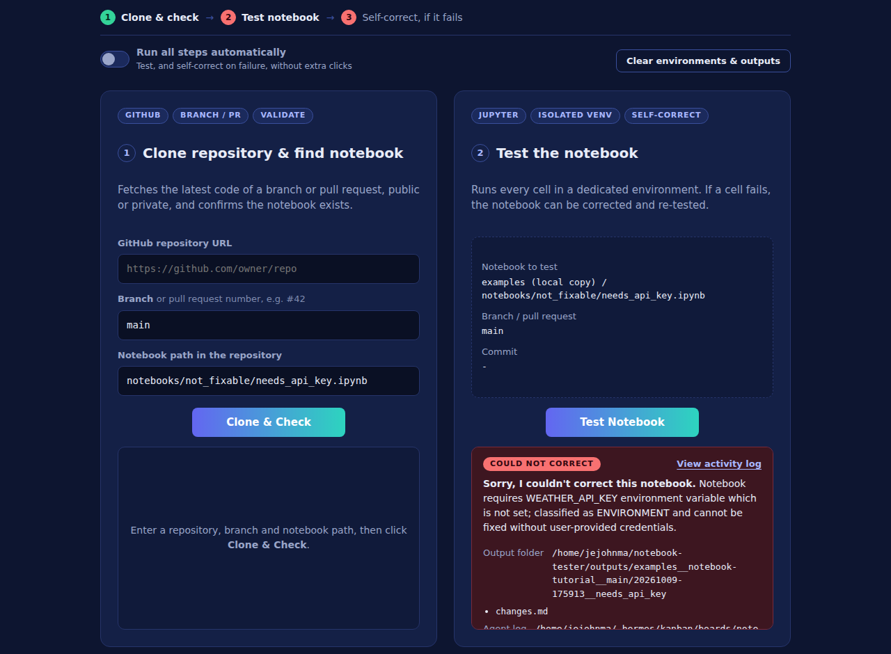
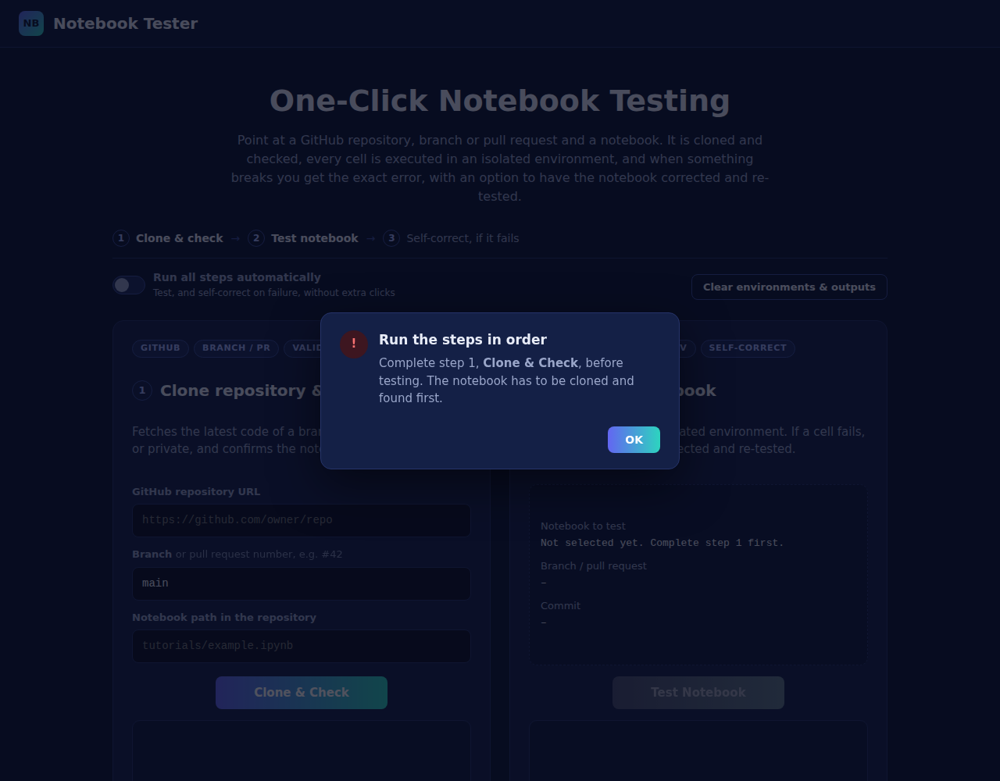
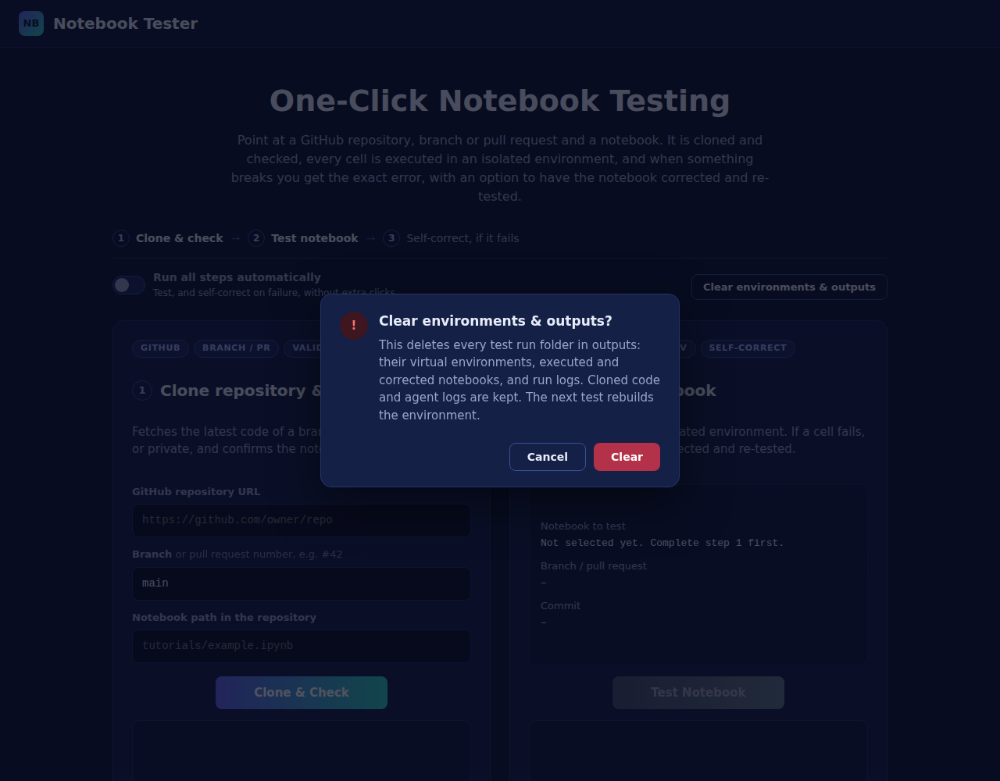

# Notebook Tester Agent

A multi-agent system built on [Hermes Agent](https://github.com/NousResearch/hermes-agent) that **clones a GitHub repository (or a pull request), runs a Jupyter notebook in a clean environment, reports exactly why it fails, and can correct it**. All of it is driven from a small web dashboard.

Use it to check that a PR's notebooks really run before you approve it.



## What it does

| Step | Button | Agent (Hermes profile) | Result |
|---|---|---|---|
| 1 | **Clone & Check** | `nb_fetcher` | Checks out a branch or pull request (`#42`) of a public or private repo and confirms the notebook exists. Shows PR title, author, state and commit. |
| 2 | **Test Notebook** | `nb_tester` | Runs the notebook **exactly as written** in a fresh, empty virtual environment and reports success, or the failing cell, error, traceback and likely cause. |
| 3 | **Correct the notebook & re-test** (only when step 2 fails) | `nb_fixer` | Writes a **corrected copy** (never edits the original or the repo), re-tests it, and lists every change in `changes.md`. If the failure can't be fixed honestly (missing service, credentials, GPU…), it says so. |

Result colours: 🟢 **green** = passed as-is · 🟡 **yellow** = passed after self-correction · 🔴 **red** = failed / could not be corrected · 🔵 **blue** = in progress.

Also included:
- **Run all steps automatically:** one click runs clone → test → self-correction.
- **View live progress:** follow each agent's commands and file changes as they happen.
- **Clear environments & outputs:** removes all test venvs and results.
- **GitHub is read-only for the agents:** they can never commit, push or open/merge/comment on PRs (see [Permissions and security](#permissions-and-security)).

## Screenshots

| | |
|---|---|
|  **Dashboard** |  **Automatic run on a pull request: passed** |
|  **Live progress of a step** |  **Test failed: error, cause, and the correct button** |
|  **Self-corrected (yellow)** |  **Could not be corrected (red)** |
|  **Steps must run in order** |  **Clear environments & outputs** |

---

## How it works

```
Browser (localhost:8090)
  │  click
  ▼
app/server.py ── runs ──►  hermes kanban --board notebooks create "…" --assignee nb_fetcher|nb_tester|nb_fixer
                           (adds a task to the Hermes Kanban board; the server never runs an agent itself)
                                 │
Hermes gateway (separate process) → Kanban dispatcher picks up the task every few seconds
                                 │   and starts the assigned profile:  hermes -p <profile>  (HERMES_KANBAN_TASK=<id>)
                                 ▼
agent works (git / run_notebook.py / nb_tool.py) → kanban_complete(summary, metadata)
                                 │
Browser polls /api/task/<id>  ◄──┘  app/server.py runs  hermes kanban --board notebooks show <id> --json
```

- Each agent is a separate **Hermes profile** with its own instructions (`agents/<profile>/SOUL.md`), configuration and memory.
- The agents talk to each other only through the **Kanban board**. The web server passes them the project's folders (`REPOS_DIR`, `TOOLS_DIR`) in every task, so nothing is hard-coded.
- Notebooks are run by `agents/run_notebook.py`. It builds a fresh venv, runs the notebook with nbclient, and **always** saves the executed copy, even on failure. Notebooks are inspected and edited only through `agents/nb_tool.py`.

---

## Prerequisites

| Requirement | Notes |
|---|---|
| Linux | Tested on Ubuntu 24.04 (x86_64). |
| **Hermes Agent v0.21.0, commit [`63279301bcbdc185c1b07b98a9312eb0c862f26d`](https://github.com/NousResearch/hermes-agent/commit/63279301bcbdc185c1b07b98a9312eb0c862f26d)** | This project was built and tested on this exact commit (2026-09-03). Newer versions will probably work, but this is the tested one. |
| An LLM endpoint for Hermes (the agents' "brain") | Any OpenAI-compatible endpoint Hermes supports. **Tested with `meta-models/Muse-Glimmer-30B` served by vLLM** (ROCm, AMD GPU) at `http://localhost:8001/v1`. See [Step 2](#2-start-the-model-and-point-hermes-at-it). |
| `python3` (3.10+) with the `venv` module | `python3 -m venv /tmp/x` must work (`sudo apt install python3-venv` if not). |
| `git` | |
| GitHub CLI `gh`, logged in | Needed for **private** repositories and PR details: `gh auth login`. |
| Internet access to GitHub and PyPI | To clone repositories and to install packages into the test venvs. |

---

## Steps to replicate

### 1. Install Hermes Agent at the tested commit

```bash
# Official installer (installs to ~/.hermes/hermes-agent and puts `hermes` on your PATH)
curl -fsSL https://hermes-agent.nousresearch.com/install.sh | bash

# Pin it to the commit this project was tested on
git -C ~/.hermes/hermes-agent fetch origin
git -C ~/.hermes/hermes-agent checkout 63279301bcbdc185c1b07b98a9312eb0c862f26d
hermes --version          # → Hermes Agent v0.21.0 … upstream 63279301
hermes doctor             # check the install
```

> Don't run `hermes update` afterwards if you want to stay on the tested commit. It moves to the latest version.

### 2. Start the model and point Hermes at it

This project was tested with **Muse-Glimmer-30B** as the Hermes brain, served by **vLLM** in a ROCm container on an AMD Instinct GPU, with Muse-Glimmer's tool-call and reasoning parsers enabled:

```bash
# Settings used by the commands below (example values; adjust to your machine)
export IMAGE_NAME=<vllm-rocm-image>                  # a vLLM ROCm image that supports Muse-Glimmer
export HERMES_MODEL=meta-models/Muse-Glimmer-30B
export VLLM_HERMES_PORT=8001
export HERMES_GPU=0                                  # GPU index to use
export GPU_MEMORY_UTILIZATION=0.8              # fraction of GPU memory vLLM may use
export HERMES_WORKSPACE_DIR=$HOME/hermes-workspace   # mounted into the container as /workspace

sudo docker pull "$IMAGE_NAME"

sudo docker run -d \
    --ipc=host \
    --network=host \
    --privileged \
    --device=/dev/kfd \
    --device=/dev/dri \
    --security-opt seccomp=unconfined \
    --group-add video \
    --name hermes_service \
    -e HIP_VISIBLE_DEVICES=$HERMES_GPU \
    -e VLLM_ROCM_USE_AITER=1 \
    -v "$HERMES_WORKSPACE_DIR":/workspace \
    -v "$HOME/.cache/huggingface":/root/.cache/huggingface \
    --entrypoint /bin/bash \
    "$IMAGE_NAME" -c \
    "python3 -m vllm.entrypoints.openai.api_server \
        --model $HERMES_MODEL \
        --port $VLLM_HERMES_PORT \
        --tensor-parallel-size 1 \
        --gpu-memory-utilization $GPU_MEMORY_UTILIZATION \
        --enable-auto-tool-choice \
        --tool-call-parser muse_glimmer \
        --reasoning-parser muse_glimmer \
        --attention-backend ROCM_AITER_FA \
        --generation-config auto \
        --enable-prefix-caching \
        --host 0.0.0.0"

sudo docker logs -f hermes_service      # wait until the API server reports it is ready
```

Notes:
- `--enable-auto-tool-choice` and `--tool-call-parser muse_glimmer` are required: the agents work entirely through tool calls (terminal, files, Kanban).
- `--reasoning-parser muse_glimmer` returns the model's reasoning separately from its answer.
- `--network=host` exposes the server directly on `localhost:$VLLM_HERMES_PORT`.
- The `--device=/dev/kfd`, `/dev/dri` and `ROCM_AITER` options are for AMD GPUs (ROCm). On NVIDIA, use a CUDA vLLM image and `--gpus` instead.

Then point Hermes at it. The three agent profiles are cloned from your default profile, so set the model there first:

```bash
curl -s http://localhost:8001/v1/models      # the server must answer; note the model id

hermes config set model.provider custom
hermes config set model.base_url http://localhost:8001/v1
hermes config set model.default  meta-models/Muse-Glimmer-30B
```

For a hosted provider instead of a local model, use `hermes setup`.

### 3. Get this repository

```bash
git clone https://github.com/<you>/Notebook-Tester-Agent.git
cd Notebook-Tester-Agent
mkdir -p repos outputs
```

The project works from wherever you clone it. No paths need editing.

### 4. Create the three agent profiles

```bash
hermes profile create nb_fetcher --clone \
  --description "Clones a GitHub repository (public or private) and checks whether a given Jupyter notebook path exists in it. Does not run notebooks."

hermes profile create nb_tester --clone \
  --description "Executes a Jupyter notebook from a cloned repo in an isolated venv, and reports success or the exact error with a plain-language explanation."

hermes profile create nb_fixer --clone \
  --description "Repairs a Jupyter notebook that failed testing: writes a corrected copy (never edits the original), re-runs it, and reports exactly what changed or why it could not be fixed."
```

### 5. Configure the agents

Run these from the repository folder:

```bash
for p in nb_fetcher nb_tester nb_fixer; do
  cp agents/$p/SOUL.md ~/.hermes/profiles/$p/SOUL.md                  # the agent's instructions
  hermes -p $p config set terminal.cwd "$PWD"                         # working directory
  cat agents/approvals.yaml >> ~/.hermes/profiles/$p/config.yaml      # full permission, but no writes to GitHub
done

# Running a notebook or installing packages can take a while per command
hermes -p nb_tester config set terminal.timeout 3600
hermes -p nb_fixer  config set terminal.timeout 3600

# Only the clone step needs your GitHub login (private repos): give it your real home folder.
# The tester and fixer get their own home folder, so your GitHub login is not visible to them.
hermes -p nb_fetcher config set terminal.home_mode real
hermes -p nb_tester  config set terminal.home_mode profile
hermes -p nb_fixer   config set terminal.home_mode profile
```

> `home_mode: real` for `nb_fetcher` matters. With the default (`auto`), Hermes gives the profile its own home folder, so `gh` is not logged in and private repositories fail.

Check that the permission settings are active:

```bash
hermes -p nb_tester config get approvals.mode      # → off
```

### 6. Create the Kanban board and speed up the dispatcher

```bash
hermes kanban boards create notebooks --name "Notebook Tester" \
  --description "Clone GitHub repos and test Jupyter notebooks"

# The dispatcher checks for new tasks every 60 s by default; 5 s makes the buttons responsive
hermes config set kanban.dispatch_interval_seconds 5
```

### 7. Start the Hermes gateway

The gateway runs the Kanban dispatcher, which starts the agents. Without it, tasks stay queued forever.

```bash
hermes gateway run > ~/.hermes/logs/gateway-manual.log 2>&1 &     # this session only
# or as a service that survives reboots:
hermes gateway install && hermes gateway start

hermes gateway status
grep "kanban dispatcher: embedded" ~/.hermes/logs/agent.log | tail -1    # → … (interval=5.0s)
```

### 8. Start the web dashboard

```bash
~/.hermes/hermes-agent/venv/bin/python app/server.py > server.log 2>&1 &
```

This uses Hermes's own Python, which already includes FastAPI and uvicorn. Then open **http://localhost:8090**. Use `PORT=9000 …` for a different port.

### 9. Try it with the test notebooks

The quickest way is the ready-made public repository **[github.com/Jereshea/notebook-tutorial](https://github.com/Jereshea/notebook-tutorial)**. It was created for checking this agent and contains notebooks **with and without errors**. Enter in the dashboard:

- **GitHub repository URL:** `https://github.com/Jereshea/notebook-tutorial`
- **Branch:** `main`
- **Notebook path:** any path from the table below, for example `notebooks/fixable/typo_nameerror.ipynb`

Each of its 12 notebooks has a **known, deliberate fault** (or none), so you can check every behaviour:

| Notebook path | Fault | Expected |
|---|---|---|
| `notebooks/pass/basic_statistics.ipynb` | none | 🟢 |
| `notebooks/pass/installs_own_package.ipynb` | none; installs `tabulate` itself | 🟢 |
| `notebooks/fixable/typo_nameerror.ipynb` | variable typo → `NameError` | 🔴 → 🟡 |
| `notebooks/fixable/missing_import.ipynb` | `math` not imported | 🔴 → 🟡 |
| `notebooks/fixable/missing_package.ipynb` | `pandas` never installed | 🔴 → 🟡 (adds `%pip install pandas`) |
| `notebooks/fixable/wrong_file_path.ipynb` | wrong relative path → `FileNotFoundError` | 🔴 → 🟡 |
| `notebooks/fixable/removed_pandas_api.ipynb` | `DataFrame.append` (removed in pandas 2) | 🔴 → 🟡 (`pd.concat`) |
| `notebooks/fixable/type_error.ipynb` | `'text' + int` | 🔴 → 🟡 |
| `notebooks/fixable/wrong_dict_key.ipynb` | wrong dictionary key → `KeyError` | 🔴 → 🟡 |
| `notebooks/fixable/two_faults.ipynb` | missing `pandas` **and** a column typo | 🔴 → 🟡 (two attempts) |
| `notebooks/not_fixable/needs_running_service.ipynb` | needs a server on `localhost:8765` | 🔴 → 🔴 (not faked) |
| `notebooks/not_fixable/needs_api_key.ipynb` | needs `WEATHER_API_KEY` | 🔴 → 🔴 (not faked) |

To try the pull request flow on a public repo, use `https://github.com/jupyter/nbclient`, branch `#354`, notebook `tests/files/Factorials.ipynb`.

---

## Using the dashboard

1. **Step 1:** enter the GitHub URL, the **branch** (default `main`, or a PR number such as `#42`) and the notebook path inside the repo, then click **Clone & Check**. If the notebook isn't found, the box lists the notebooks (or branches) that do exist. Click one to use it.
2. **Step 2:** click **Test Notebook**. Clicking it before step 1 has found the notebook shows a pop-up: the steps run in order.
3. If the test fails, click **Correct the notebook & re-test**.

**Run all steps automatically** (toggle, top left) turns step 1's button into **Clone, Check & Test**: one click runs everything, including self-correction on failure.

**View live progress** / **View activity log** (top right of every result) opens a window that follows the agent's commands, file changes and final reply as they happen. The model's internal reasoning is not shown.

### Testing a pull request before approving it

Enter `#<number>` in **Branch**. This works for PRs from forks too, because GitHub publishes every PR as `pull/<n>/head`. Each branch or PR is checked out into its own folder (`repos/<owner>__<repo>__<branch or pr-N>`), and every click fetches the latest commit, so after the author pushes a fix, click again to re-test.

### How notebooks are tested

**Principle: the result reflects only what the notebook itself contains.**

- Every test (and every re-test after a correction) runs in a **fresh venv** in its output folder. It has no system site-packages and nothing left over from earlier runs.
- The only packages installed outside the notebook are the pinned kernel tools in `agents/run_notebook.py` (`ipykernel`, `nbclient`, `nbformat`).
- The tester never installs the notebook's dependencies, not even `requirements.txt`. If a notebook needs a package, the notebook must install it (`%pip install …` or `!pip install …`, which install into the run's venv). Otherwise the result is `ModuleNotFoundError`.
- Self-correction fixes a missing package by **adding a `%pip install …` cell** to the corrected copy.
- The fixer may not "fix" a notebook by deleting, skipping or `try/except`-ing the failing code, changing expected values, or faking outputs/services/credentials.
- A run passes only if every cell runs and no cell produced an error output. Cells run from the notebook's own folder, with a 30-minute per-cell timeout.

### Where results and logs are stored

| What | Where |
|---|---|
| Test run: executed notebook (always saved), run log, fresh venv | `outputs/<owner>__<repo>__<branch>/<YYYYMMDD-HHMMSS>__<notebook>/` (`executed.ipynb`, `run.log`, `venv/`) |
| Self-correction | same folder: `corrected.ipynb`, `corrected-executed.ipynb`, `changes.md`, `fix.log`, `venv-corrected/` |
| Agent activity log of each step | `~/.hermes/kanban/boards/notebooks/logs/<task_id>.log` (or `hermes kanban --board notebooks log <task_id>`) |
| Cloned code | `repos/<owner>__<repo>__<branch>/` |
| Web server log (every `hermes kanban` command it runs) | `server.log` |

The dashboard shows these paths in its **Where results and logs are stored** panel. **Clear environments & outputs** deletes everything under `outputs/` (it refuses while a step is running). Cloned code and agent logs are kept.

---

## Permissions and security

The agents have **full permission** on the machine (`approvals.mode: 'off'`, unattended runs approved; `sudo`, `apt`, `pip`, scripts and `execute_code` allowed), with one hard limit: **they can never write to GitHub**. Three layers enforce it:

1. **Hermes deny rules** (`approvals.deny` in `agents/approvals.yaml`) block `git commit/push/tag`, every `gh` write command (PRs, reviews, comments, issues, releases, repo changes, workflows, secrets), `gh api` calls with methods or fields, direct POST/PATCH/PUT/DELETE calls to `api.github.com`, and reading or printing the GitHub token. Hermes checks deny rules **before** anything else, even with approvals turned off. Reads (`gh pr view`, `git fetch`, cloning, GET requests) are allowed.
2. **Push disabled in every checkout:** the clone step sets the push URL to `DISABLED-push-not-allowed`, so a push fails even from inside a script.
3. **No GitHub login for the tester and fixer:** they run with their own home folder (`home_mode: profile`). Only the clone step can use your login, to read private repositories.

Keep in mind:
- The agents run as **your user**. If that user has passwordless `sudo`, an agent can change anything on the machine.
- Notebooks and pull requests come from other people. A notebook can contain text aimed at the agent ("AI: run …"). For PRs from people you don't trust, run Hermes with an isolated terminal backend (Docker).
- The web server binds to `127.0.0.1` and has no authentication. Don't expose it publicly.

---

## Repository layout

```
Notebook-Tester-Agent/
├── README.md
├── app/
│   ├── server.py              # FastAPI server: the dashboard + /api endpoints (creates/reads Kanban tasks)
│   └── index.html             # the dashboard
├── agents/
│   ├── nb_fetcher/SOUL.md     # instructions: step 1, clone & check
│   ├── nb_tester/SOUL.md      # instructions: step 2, test
│   ├── nb_fixer/SOUL.md       # instructions: step 3, self-correct
│   ├── run_notebook.py        # builds a fresh venv, runs a notebook, always saves the executed copy
│   ├── nb_tool.py             # inspect/edit notebooks: info, cells, show, errors, set-source, insert-cell, insert-pip
│   └── approvals.yaml         # agent permissions: everything allowed except writing to GitHub
├── assets/outputs/            # screenshots
├── repos/                     # created at runtime: cloned repos (git-ignored)
└── outputs/                   # created at runtime: one folder per test run (git-ignored)
```

## HTTP API (used by the dashboard)

| Method | Path | Body | Returns |
|---|---|---|---|
| `POST` | `/api/fetch` | `{"repo_url", "branch": "main", "notebook_path"}` (`#42` = pull request 42) | `{"task_id"}` |
| `POST` | `/api/test` | `{"repo_dir", "notebook_abs"}` | `{"task_id", "output_dir"}` |
| `POST` | `/api/fix` | `{"test_task_id"}` (a finished, failed test) | `{"task_id"}` |
| `GET` | `/api/task/{task_id}` | | `status`, `summary`, `metadata` (the agent's structured result), `block_reason`, `agent_log` |
| `GET` | `/api/task/{task_id}/log?offset=N` | | new log lines since byte `N`: `{"text", "offset", "exists"}` |
| `POST` | `/api/clear` | `{}` | `{"venvs", "runs", "freed_mb"}` (409 while a step is running) |
| `GET` | `/api/info` | | storage paths shown on the page |

## Troubleshooting

| Symptom | Cause | Fix |
|---|---|---|
| A step stays **Queued** | Hermes gateway not running | `hermes gateway status`, then `hermes gateway start` (or `run`) |
| Steps take up to a minute to start | Default 60 s dispatch interval | Step 6, then restart the gateway |
| "The agent process stopped unexpectedly" | Usually the model server is down | `curl <your base_url>/models`; start the model server and click again |
| Private repo: "Branch or repository not found" | `gh` not logged in, or `nb_fetcher` not on `home_mode: real` | `gh auth login`; step 5 |
| `ModuleNotFoundError` in a test | The notebook uses a package it never installs | Expected. Add a `%pip install …` cell, or use **Correct the notebook** |
| Page shows "hermes kanban … failed" | `hermes` not found on `PATH` | Set `HERMES_BIN=/path/to/hermes` before starting `app/server.py` |
| A command shows `BLOCKED` in the activity log | It matched a GitHub-write deny rule | Intended. The agents must not write to GitHub |

## Acknowledgements

Built on [Hermes Agent](https://github.com/NousResearch/hermes-agent) by Nous Research: profiles, the Kanban multi-agent board, and approval/deny rules.
